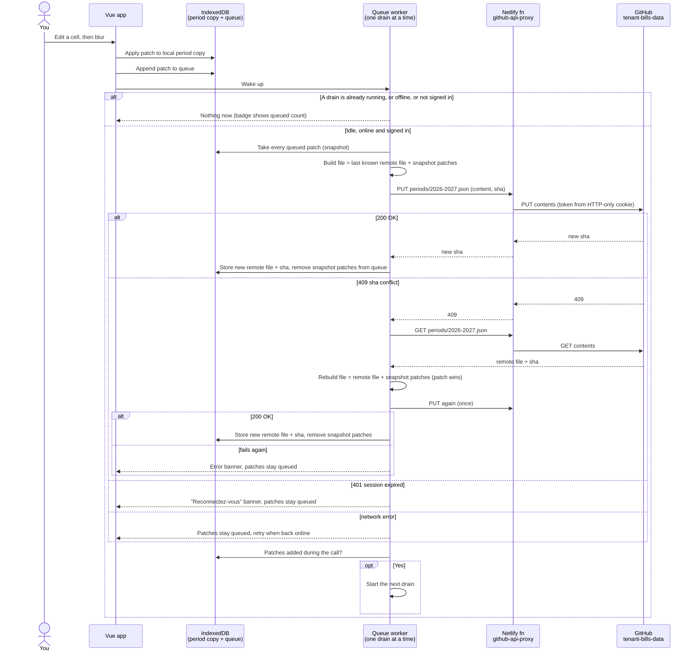

# Grilling round v03 — functional breakdown of the tenant bills app

## Settled in v02

- Q11b: the suggested reading date is the 15th if it falls Thu-Sun, otherwise the Sunday before the 15th (Mon > 14th, Tue > 13th, Wed > 12th). It is only a suggestion: you can always override "Au".
- Q14b: on every app load, the app compares the remote file SHA with the local copy and pulls when they differ. A manual "Rafraîchir" action is also available. Both are refused while edits are still queued.
- Q16: the data repo is fixed in Netlify environment variables (no settings form). The proxy only accepts paths inside it. Each period is one file, `periods/2026-2027.json`, and the app lists `periods/` to know which periods exist.
- Q17: a worker drains everything queued when it starts and sends it as one `PUT` (one commit). Edits made during that call wait for the next drain. Still to approve with a diagram: see Q17b.
- Q18: on a 409, the app pulls the remote file, re-applies the queued cell edits on top of it and retries once. The queued edit wins on a cell changed on both sides.
- Q19: edits are accepted offline (IndexedDB + queue, with a badge counting the edits not yet sent), **and** the app is offline-ready with a service worker. This replaces my "no service worker in v1". Its open details are Q19b and Q19c.
- Q20: the period table shows on large screens, and a "Saisie du mois" form for one month, grouped by section, shows on small screens. Both write through the same queue.
- Q21: v1 has a "Nouvelle période" action where you type the first month's values. The prefill from the previous period is planned for v2.
- Q22: no import: you type the 2026-2027 months already in the spreadsheet.
- Q23: the softener description and quantity are not inherited (empty means no purchase); the unit price is inherited.

## Q17b - Approve the save queue flow

The diagram covers Q17 (drain) and Q18 (409 conflict). "Patch" means one queued edit: `{ period, month, field, value }`, where an empty `value` clears the override (see Q26).

➡️ Recommendation: yes, approve it as drawn.

### Answer to Q17b

## Q19b - Installable app

The service worker makes the app shell work offline. It can also come with a web manifest so you can install the app on the phone's home screen.

➡️ Recommendation: yes, installable (manifest with name, icons and `display: standalone`), built with `vite-plugin-pwa`. Taking readings on the phone is the main offline case, and an installed app opens without the browser UI.

### Answer to Q19b

Recommendation is correct

## Q19c - App update when a new version is deployed

- a. Automatic: the new service worker takes over on the next load.
- b. Prompt: a "Nouvelle version disponible — Recharger" banner, applied only when you click it.

➡️ Recommendation: b. An automatic reload while a cell is being edited could lose the value not yet blurred; the prompt lets you finish first.

### Answer to Q19c

B

## Q24 - Restrict sign-in to your GitHub account

Any GitHub user can complete the OAuth flow. They would get a 404 on the private data repo, but they would still be "signed in" to the app.

➡️ Recommendation: the auth callback checks the GitHub login against an allowlist in a Netlify environment variable (`JeremieLitzler`) and refuses everyone else, so no foreign token ever gets a cookie.

### Answer to Q24

Recommendation is correct

## Q25 - Settlement view scope

- a. Only for a closed period (all 12 months entered).
- b. For any period, computed with the months entered so far, labelled "provisoire" until the period is closed.

The view shows, per section, the tenant share per month and in total, the charge advances received, the balance with who owes whom, and the next charge advance ("Nouvelle annualisation" = total tenant shares / 12).

➡️ Recommendation: b. A running balance tells you during the year whether the 70 € advance is still right, at no extra cost since everything is computed (ADR 0001).

### Answer to Q25

B

## Q26 - Clearing a cell

When you empty a cell that overrides an inherited value (a price, an occupant count, a current index):

➡️ Recommendation: clearing removes the override, and the cell shows the inherited value again. For a current index, which has nothing to inherit, it goes back to empty and its section's lines for that month show "—" instead of a computed amount.

### Answer to Q26

Give an example

## Q27 - Implausible values

Example: a current index lower than the previous index, or a reading date before the previous one.

- a. Block the save.
- b. Save, but highlight the cell with a warning ("Index inférieur au précédent").

➡️ Recommendation: b. Meter replacements and typos you will fix later are both real, and blocking on blur would lose the value.

### Answer to Q27

B

## Q28 - Formula tests against the spreadsheet

➡️ Recommendation: the formulas are pure TypeScript functions tested with Vitest, and the expected values come from the 2026-2027 sheet's computed cells (September and October) and a few 2025-2026 months, except where ADR 0003 changes the formula. This proves the app gives the same numbers as the sheet before you stop using it.

### Answer to Q28

Recommendation is correct.

## Q29 - Feature list

This is the breakdown the implementation trees will hang off. Everything settled so far maps to one of these:

1. **F1 Auth**: GitHub OAuth through Netlify functions, HTTP-only cookie, login allowlist (Q24), sign out.
2. **F2 Data proxy and sync**: `github-api-proxy` restricted to the data repo; list/get/put of `periods/*.json`; SHA check on load and manual "Rafraîchir" (Q14b).
3. **F3 Local store and save queue**: IndexedDB period copies, patch queue, single drain worker, 409 rebase, offline badge (Q17-Q19).
4. **F4 Domain model and formulas**: period/month/inputs types, inheritance (Q4), every section's computed lines, reading date suggestion (Q11b), plausibility warnings (Q27).
5. **F5 Period table**: the sheet-like editable table, save on blur, inherited styling, tariff mode and subscription unit switches (Q8-Q9).
6. **F6 Monthly entry form**: the phone "Saisie du mois" form (Q20).
7. **F7 Period management**: list periods, pick the current one by default, "Nouvelle période" with manual first month and period settings (monthly advance, PAC amount) (Q21).
8. **F8 Settlement view**: provisional or final settlement (Q13, Q25).
9. **F9 PWA**: service worker, manifest, update prompt (Q19b-c).
10. **F10 Hosting and CI**: Netlify site, environment variables, build and test on pull requests.

➡️ Recommendation: yes, this is the feature list for v1, in roughly this build order (F4 can start first since it needs nothing else). "Nouvelle période" prefill and a tenant view are v2.

### Answer to Q29

F10 should go first, because F1 and on require it.
