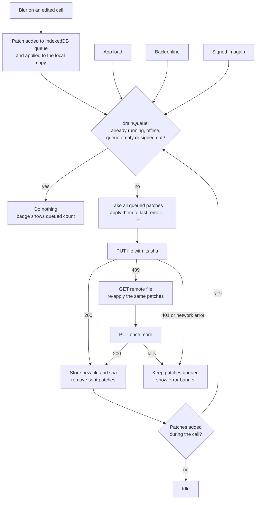

# Grilling round v05 — functional breakdown of the tenant bills app

## Settled in v04

- Q30: the clearing example is correct.
- Q30b: emptying a cell removes its stored value. An inheritable cell shows the inherited value again. A non-inheritable cell (current index, charge advance, softener quantity) becomes empty, and the amounts that depend on it show "—". Typing 0 still means zero.

## Reopened

- **Q17b** (approve the save queue flow): you found it complex and asked what triggers the "wake up". Q31 answers that and redraws the flow more simply. Q31b asks for the approval again.

## Q31 - What starts a drain

"Wake up" only means "try to start a drain". The worker is not a separate process. It is one function, `drainQueue()`, and a flag saying whether it is already running. Five events call it:

1. **A blur** that added a patch to the queue: the normal case.
2. **App load**, after the SHA check (Q14b): sends edits left queued by a previous session (tab closed, phone offline).
3. **The browser going back online** (the `online` event): sends edits typed offline (Q19).
4. **Signing in again** after a 401: sends edits that waited for a new session.
5. **The end of a drain** when patches were added during the call: sends them right away, instead of waiting for the next blur.

`drainQueue()` returns at once when a drain is running, the browser is offline, the queue is empty or you are not signed in. Its single rule is "at most one `PUT` at a time".

The same flow, as a flowchart with the GitHub details left out:

The v03 sequence diagram and this flowchart describe the same behaviour. Only the drawing changed.

➡️ Recommendation: nothing to answer unless something above is wrong or still unclear.

### Answer to Q31

It is clearer with the flowchart.

## Q31b - Approve the save queue flow

The save queue works as the Q31 flowchart shows: five triggers call `drainQueue()`, with at most one `PUT` at a time; a 409 pulls the remote file, re-applies the patches and retries once; a 401 or network error keeps the patches queued.

➡️ Recommendation: yes, approve it. If you want it simpler still, the place to cut is the automatic 409 retry (Q18). Without it, a conflict keeps the patches queued and shows a banner with a "Réessayer" button, at the cost of one extra click when both devices edited the same period.

### Answer to Q31b

approved
