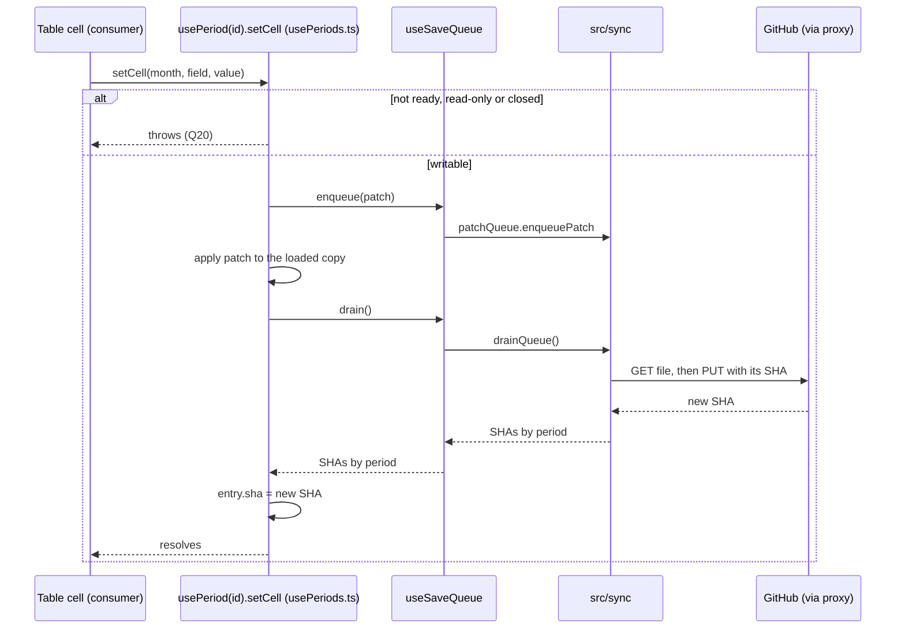

# Grilling summary - feedback on the code review of #48 (One edit reaches the data repo)

## Shared understanding

Issue #48 was implemented in `feat(sync): queue an edit as a patch and drain it as one commit (#48)`, then a second commit fixed two defects found by a two-agent review (`estimated` written third instead of last in `common`, and unrelated Prettier changes in five files). The review left 14 judgment calls; the drill settled them in four rounds.

The changes to apply, grouped by what they touch:

- **The drain (`src/sync/drainQueue.ts`).** A period that cannot be written no longer blocks the others: the drain skips it, keeps its patches queued, drains the rest, then throws. The error carries the new SHAs of the periods already written, so their loaded copy does not keep a stale SHA. The drain keeps reading the remote file before it writes (one extra `GET`); this avoids most 409 conflicts, not the one where the other device writes between our `GET` and our `PUT`, which #52 handles.
- **`setCell`.** It becomes a pure command (CQS): it resolves to nothing and throws when the period is not ready, is read-only or is closed, because the caller should have checked `isReadOnly`. This replaces the `true` / `false` first chosen in Q2. `window.setCell` is exposed in development only (`import.meta.env.DEV`), bound to the open period, with a spec, and is removed when F5 (#32) builds the table, so the last criterion of the issue (a commit through `netlify dev`) can be checked.
- **Failures.** `usePeriods()` exposes a `lastError` ref, cleared by the next successful drain, and the failure is also written with `console.error`. A pointer comment names #50 (sync status and banner) and #120 (global toast) as its readers.
- **Domain.** One exported `MONTH_FIELD` constant replaces the `'month'` literal in `applyPatch.ts` and `commitMessage.ts`. The body logic of `commitMessage` is simplified. A month patch whose `YYYY-MM` is not after the last month is ignored, so the app never writes a file that its own validation refuses. The multi-group and `initialize` commit shapes stay in this ticket; #53 will then only add the specs for removals and for two periods.
- **Structure.** `useSaveQueue.ts` is created and holds the queue, the drain, the pending-count mirror and `lastError`. `usePeriods.ts` keeps the loaded periods, and `usePeriod(id).setCell` stays the only door for a consumer. The dependency is one way (`usePeriods.ts` imports `useSaveQueue.ts`, which imports `src/sync/`). The "401 ends the session" block is extracted into one `expireOnUnauthorized(error)` function used in the four places. The happy path of one edit:

- **Tests.** Specs are added for `usePeriod().setCell` (in `src/composables/usePeriods.spec.ts`) and for the development `window.setCell`. `drainQueue.spec.ts` gets a new `IDBFactory` per test instead of draining to clean up.
- **Docs.** `docs/architecture.md` is corrected after the code is final: the `setCell` signature and its comment (line 109), and the two statements that `usePeriods.ts` is "the only one reaching `src/sync/`" (the State section, and the #8 reasoning it refers to).
- **Not decided here.** Pinia stays out for this issue; a new grilling issue reopens the decision of #8 later.

Nothing leaves the repo without your approval: drafts for the comments on #50, #120 and #53 and for the new Pinia grilling issue are written in this folder once the code is done, and posted only after you read them. No push and no pull request before that.

## Decision index

- Q1 (v01): skip a failing period, drain the others, keep its patches, throw at the end with the SHAs already written (option A).
- Q2 (v01): `setCell` resolves to `true` / `false` (option A); replaced by Q20.
- Q3 (v01) re-asked as Q15 (v02): `lastError` ref and `console.error`, with a pointer comment to #50 and #120 (option D); comments on #50 and #120 once the drill is done.
- Q4 (v01): the multi-group and `initialize` shapes stay in #48 (option A); #53 gets a comment.
- Q5 (v01): one exported `MONTH_FIELD` constant (option B).
- Q6 (v01): simplify the body logic of `commitMessage` (option A).
- Q7 (v01) re-asked as Q16 (v02): a new `IDBFactory` per test (option A).
- Q8 (v01) re-asked as Q17 (v02) and Q19 (v03): correct the `setCell` signature line in `docs/architecture.md` after the code is final (option A).
- Q9 (v01): the drain keeps reading the remote file before the write (option A).
- Q10 (v01): add specs for `usePeriod().setCell` (option A).
- Q11 (v01): `window.setCell` in development only, with a spec (option A).
- Q12 (v01): ignore an out-of-order month patch (option A).
- Q13 (v01): extract `expireOnUnauthorized(error)` (option A).
- Q14 (v01) re-asked as Q18 (v02), Q22 (v03) and Q23 (v04): split with a facade, `useSaveQueue.ts` plus `setCell` composing both in `usePeriods.ts` (option C).
- Q20 (v03): `setCell` is a command that resolves to nothing and throws on a refusal (option C).
- Q21 (v03): no Pinia for this issue (option A), and a new grilling issue for later (option B).

## Rejected alternatives

- Q1 B: keep stopping at the first failure (leaves the other periods frozen).
- Q1 C: drop the patches of a period that cannot be written (would discard a meter reading).
- Q2 B and C: stay silent until F5, or throw; replaced by the CQS throw of Q20 C.
- Q3 A and B: leave it silent, or only `console.error`: "B is 'silent' unless you have DevTools opened". The `console.error` stays only as part of D.
- Q4 B: remove the extra shapes and throw on any other drain (a wrong subject in the data repo history cannot be corrected).
- Q5 A and C: leave the literal as is, or make `Patch` a discriminated union (bigger change to a contract the docs already fix).
- Q6 B: leave the tangled body logic.
- Q8 / Q19 B and C: open a docs ticket on whether the document should list signatures, or replace the interface block by prose now (bigger than this ticket; B stays possible separately).
- Q9 B: write with the loaded copy's SHA and let a 409 fail until #52: "A will avoid the 409 for sure".
- Q10 B: leave the specs for F5.
- Q11 B and C: check the commit with a throwaway script, or leave the criterion unchecked: "A, so we can add a test".
- Q12 B: leave it, since only a bug could send an out-of-order month.
- Q13 B: leave the five copies.
- Q15 A, B and C alone: silent, `console.error` only, or `lastError` without a console line (D includes both).
- Q16 B: keep the workaround that drains the queue to reset the test.
- Q20 A and B: keep the `true` / `false` return (a command that also answers), or a silent no-op on refusal (the finding the review raised).
- Q21 B: reopen Pinia in this PR (moved to a separate issue, as the answer was "A for this issue, but B for later").
- Q23 A: leave `usePeriods.ts` as is, with a comment.
- Q23 B: your own proposal, the consumer orchestrating both composables with mutators on `usePeriods.ts`; replaced by C after the challenge (every consumer would repeat the four steps, and the loaded copy would be written from outside, against "Views never write `file`").

## Decided without being asked

- The name of the error carrying the SHAs in Q1 (for example a `DrainError` with a `written` map) and that the drain rethrows the first failure after draining the others.
  - Approved
- That `lastError` is cleared by the next successful drain, and that it holds the `Error` object, not a message.
  - Approved if it the next successfull drain for the same period file that has an error.
- That the order check of Q12 compares the `YYYY-MM` strings.
  - OK
- That `window.setCell` is typed on `window` in an ambient declaration and is installed by the period page on setup and removed on unmount.
  - Correct
- That `useSaveQueue.ts` is the name (yours), and that the existing `pendingPatches.ts` mirror moves into it or stays as the shared module, whichever keeps `usePeriods.spec.ts` passing with the fewest changes.
  - `pendingCountFor.ts` stays imported by `usePeriods.ts`
- That the comment, the Pinia issue and the comments on #50, #120 and #53 are drafts only until you approve them.
  - Approved
