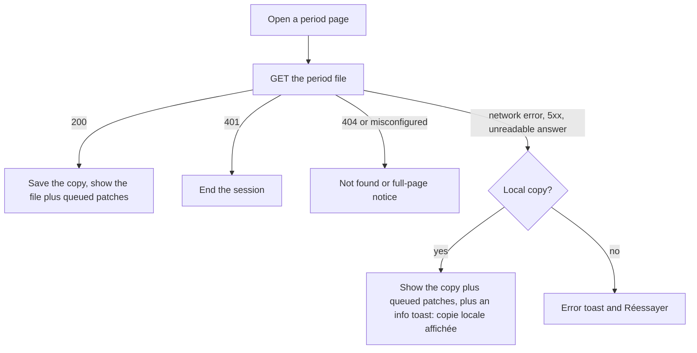

# Summary - feedback on the code review of issue #49 (Edits survive offline and reloads)

## Shared understanding

Issue #49 is implemented in commit `16faffb`: IndexedDB (version 2) holds the patch queue and a `period-copies` store with the last remote file and its SHA; a period page loads from the remote and falls back to that copy, then replays the queued patches on top; the queue drains on app load and on the browser `online` event when signed in.

The code review raised eight judgment calls. The outcome: the periods list stays without an offline fallback in this ticket and gets its own grilling issue; the copy fallback stays broad (any failure except 401, 404 and misconfigured) but now tells the landlord with an info toast; the copy read and write become best-effort inside their own module; the fetch-or-copy and patch-replay logic moves out of `usePeriods.ts` into a Vue-free function in `src/sync/` so it can be specced like `drainQueue()`; the two architecture docs are updated in this ticket; the offline > reload > online flow is checked by hand rather than by a new browser test.

The selected scenario (Q10, option C), what a period page does when the remote read fails:

## Decision index

- Q1, v01: no offline fallback for the periods list in #49; a new grilling issue covers the period list available offline.
- Q2, v01, reopened as Q10: see Q10.
- Q3, v01: `savePeriodCopy` and `readPeriodCopy` are best-effort themselves; the four `.catch(() => undefined)` are removed.
- Q4, v01: the fetch-or-copy and queued-patch replay move to a Vue-free function in `src/sync/`.
- Q5, v01: update `docs/architecture.md` and `docs/architecture-tests.md` in this ticket, after the code changes.
- Q6, v01: `App.vue` drains on load and `online` only when signed in; the sign-in trigger stays with #51.
- Q7, v01: no automated browser test; check the flow by hand before the pull request.
- Q8, v01: keep the local `withStore` alias in `patchQueue.ts`.
- Q9, v02: the diagrams of the three Q2 scenarios were read, no scenario added.
- Q10, v02: fall back to the copy on any failure except 401, 404 and misconfigured, with an info toast "copie locale affichée".

## Rejected alternatives

- Q1: cache the list of period identifiers in IndexedDB in this ticket; not chosen, deferred to its own issue.
- Q1: open a period page from a copy while the list needs the network; not chosen.
- Q2/Q10: narrow the fallback to network failures only; not chosen.
- Q2/Q10: broad fallback with no message; not chosen, the toast was preferred.
- Q3: leave each caller its own `.catch`; not chosen.
- Q4: leave the logic in `usePeriods.ts`; not chosen.
- Q5: update only `docs/architecture.md`, or leave both docs for later; not chosen.
- Q6: drain always, even signed out; not chosen.
- Q7: add an automated browser test; not chosen, no tooling in the repo.
- Q8: delete the alias and call `withStore(QUEUE_STORE, ...)` at each site; not chosen.

## Decided without being grilled

- The toast: level `info`, the French text "copie locale affichée" exactly as proposed in Q10, shown once per load from the copy, and a new key in `src/i18n/fr.ts`. This reverses my own recommendation (the toast belonged to #50), so #50 will need to know it exists.
- The new grilling issue (Q1) is drafted in this folder and created only after you approve it; nothing is posted yet.
- The new function in `src/sync/` (Q4) takes the name `loadPeriodWithCopy`; it returns the file, the SHA and whether the copy was used.
