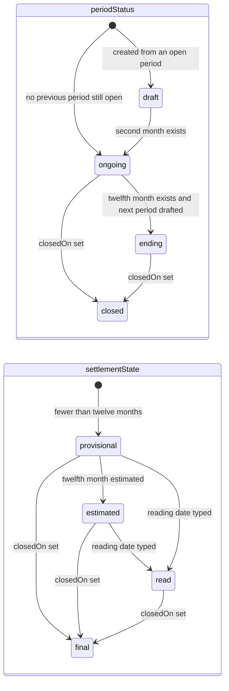

# The period file

Each period is one JSON file in the data repo `JeremieLitzler/tenant-bills-data`, at `periods/YYYY-YYYY.json` (ADR 0010 for the one file per period, ADR 0007 for the months). It stores inputs only; every delta, share, bill and balance is computed (ADR 0008). Example: [`docs/examples/2026-2027.json`](examples/2026-2027.json). The formulas that consume these inputs are in [`docs/reference/sheet-formulas.md`](reference/sheet-formulas.md), the user journeys in [`docs/scenarios.md`](scenarios.md).

## Top level

```json
{
  "schemaVersion": 2,
  "periodName": "2026-2027",
  "tenantName": "Jane Smith",
  "monthlyTenantBillAdvance": 70,
  "heatPumpInvoiceEstimate": 154,
  "closedOn": "2027-10-11",
  "months": [ ... one to twelve month entries ... ]
}
```

- `schemaVersion`: integer, currently `2`, bumped on any breaking change.
- `periodName`: `"YYYY-YYYY"`, the start year and the next one, the same as the file name. A period starts in any month, following the tenant's entrance (April to March is valid).
- `tenantName`: a label shown in the period header and on the settlement page, never used in a calculation.
- `monthlyTenantBillAdvance`: the expected monthly tenant bill advance, one value for the period. Required when the period is created. "Nouvelle période" prefills it with the previous period's next advance, CEIL(total tenant shares / 12), as shown at that moment (estimated or actual); it is not updated afterwards.
- `heatPumpInvoiceEstimate`: the annual heat pump amount asked when the period is created (can be 0). Each month's `heatPumpMaintenance.billedAmount` is filled from it when the month is initialized.
- `closedOn`: `"YYYY-MM-DD"`, the date "Clôturer la période" was pressed. Absent while the period is open.
- `months`: one to twelve entries, in order, each added when the landlord initializes the next month. The user interface shows only the months present in the file.

## The period status

The status is computed, never stored (ADR 0008):

- `draft`: the period was created from a previous one that is not yet closed and has only its first month. It becomes `ongoing` as soon as its second month exists, even if the previous period is still open (intended rule, not implemented yet: see the ticket for `periodStatus`).
- `ongoing`: the period has no previous period still open and has at least one month.
- `ending`: the twelfth month is initialized and the next period is drafted.
- `closed`: `closedOn` is present.

The settlement state is a second, independent machine, computed from the same file (`settlementState`). It shares only `closedOn` with the status:



## A month entry

```json
{
  "month": "2026-10",
  "common": { "startDate": "2026-09-12", "endDate": "2026-10-11" },
  "waterConsumption": {},
  "waterTreatment": {},
  "waterSoftener": {},
  "electricity": {},
  "internet": {},
  "heatPumpMaintenance": {}
}
```

- `month`: `"YYYY-MM"`, the calendar month in which the month's consumption window starts, set when the month is initialized and never edited afterwards. It identifies the month in the patch queue.
- The seven section objects are always present, in this order, even when empty.
- A month is complete when every input it requires is present. This is computed, never stored; it drives the highlights of the missing inputs.

## Copy, edit and apply

- When the landlord initializes the next month, the app copies into it every value marked `inherited` below, as stored, and sets each `...Previous` index to the previous month's current index. Values marked `not-inherited` start empty, and current indexes are never copied.
- The new month's `startDate` is the previous month's `endDate`; its `endDate` is prefilled by the app.
- A month is read exactly as stored. An absent key means "not typed yet", and any stored number, `0` included, means "typed".
- Editing a past month does not change the later months. After an edit of an inheritable value, one Yes/No dialog offers to apply the new value to all the following months. After an edit of a current index, the same mechanism offers to set the next month's previous index.
- A figure whose input is absent is uncomputable, shown as "—", never as zero.
- All values can be changed until the period is closed.

## Values

- Numbers are stored as typed, with no rounding.
- Water indexes are in litres, as integers (`533117` for 533.117 m³); the app shows m³.
- VAT is a multiplier: `1.055` for 5.5 %.
- Dates are `"YYYY-MM-DD"` strings.
- Enums are lowercase strings.

## Keys per section

Each key is marked `inherited` or `not-inherited`. A key ending in `Previous` is the previous index of the meter of the same name.

A section is complete when every key listed under it is present, `0` counting as present, except `estimated` and the exceptions below; a month is complete when its seven sections are (`monthCompleteness`). The electricity section needs only the registers of the month's `tariffMode` (`base`: `mainBase`, `studioBase`, their `Previous` keys and `kwhPriceBase`; `hchp`: the Hc and Hp registers of both meters, their `Previous` keys, `kwhPriceHc` and `kwhPriceHp`). The water softener is complete when empty or when `quantity` is `0`; a non-zero `quantity` also needs `unitPrice` and `description`.

### `common`

- `startDate` (not-inherited): the date "Du", the previous month's `endDate`.
- `endDate` (not-inherited): the date "Au", the day the meters are read. It closes the month's window for every section.
- `landlordOccupants`, `tenantOccupants` (inherited): occupant counts.
- `tenantBillAdvance` (not-inherited, starts at `0`): the amount the tenant actually transferred that month.
- `estimated` (not-inherited): `true` on the estimated twelfth month, set when the twelfth month is initialized and removed when the real reading is confirmed. Closing the period is refused while it is set.

### `waterConsumption`

- `mainMeter`, `studioUnsoftenedMeter`, `studioSoftenedMeter` (not-inherited): current indexes, in litres.
- `mainMeterPrevious`, `studioUnsoftenedMeterPrevious`, `studioSoftenedMeterPrevious` (copied from the previous month's current index): previous indexes, in litres.
- `pricePerM3`, `resourceWithdrawalFee`, `drinkingWaterFee`, `networkPerformanceFee` (inherited): prices per m³.
- `subscription` (inherited): the monthly subscription.
- `vat` (inherited).

### `waterTreatment`

The indexes are those of `waterConsumption`; they are not stored twice.

- `monthlySubscriptionDistributor`, `monthlySubscriptionCommunity` (inherited): the collection subscription, split by occupant counts.
- `collectionConsumptionDistributor`, `collectionConsumptionCommunity`, `sanitationPerformance` (inherited): prices per m³.
- `vat` (inherited).

### `waterSoftener`

At most one purchase per month; several purchases are summed into one. A month without a purchase has an empty object, and is complete.

When a key is typed, the form validates (an error, not a file problem): a `quantity` of `0` is complete; a non-zero `unitPrice` with a zero `quantity` is refused; a non-zero `quantity` requires a `unitPrice`; when both are non-zero, `description` is required.

- `description` (not-inherited), `quantity` (not-inherited), `unitPrice` (not-inherited).

### `electricity`

- `tariffMode` (inherited): `"base"` or `"hchp"`. Only the registers of the mode are required and summed; the keys of the other mode are kept and ignored.
- `subscriptionUnit` (inherited): `"day"` (the number of units is the number of days between `startDate` and `endDate`) or `"month"` (one unit).
- `mainBase`, `mainHc`, `mainHp`, `studioBase`, `studioHc`, `studioHp` (not-inherited): current indexes, in kWh.
- the same six keys ending in `Previous` (copied from the previous month's current index): previous indexes.
- `excisePerKwh` (inherited): the CSPE / excise rate.
- `kwhPriceBase`, `kwhPriceHc`, `kwhPriceHp` (inherited): prices excluding tax.
- `subscriptionPerUnit` (inherited): subscription per day or per month, excluding tax.
- `ctaTax` (inherited): the CTA amount.
- `vat` (inherited).

### `internet`

- `billedAmount` (inherited): the monthly bill, one number.

### `heatPumpMaintenance`

- `billedAmount` (not-inherited): the amount charged that month. When a month is initialized, the app fills it from `heatPumpInvoiceEstimate`: ROUND(annual / 12, 2) for the first eleven months and the remainder in the twelfth. The user can edit it, for example to the real invoice. The tenant pays the whole bill, so the section's header row shows its period total in the Total column (the section has no `tenantShare` line).

## Closing a period

- "Clôturer la période" is enabled when the twelve months exist, every month is complete and none is estimated. The confirmation lists the months whose `tenantBillAdvance` is `0`, without blocking, and requires ticking that the period's water bills were received and typed (ADR 0011).
- A closed period is read-only and cannot be reopened. A patch queued before the close reached the file still applies, and the app flags it.
- "Nouvelle période" is refused while the previous period's file exists and its twelfth month is neither estimated nor read. Without a previous file, it is allowed.

## The estimated twelfth month

- When the twelfth month is initialized, the app writes an estimated current index for each meter into the new month entry and sets `common.estimated` (scenario Case 6): the eleventh month's current index plus the meter's delta in the previous period's twelfth month, or in this period's eleventh month when that delta is missing.
- The delta is a total per meter: HC + HP when the source month was in `hchp`. When the twelfth month is in `hchp`, the total is split 30 % HC, 70 % HP; in `base`, it goes to the Base register.
- Confirming the real reading removes the flag; the confirmation lists the indexes still equal to their estimate.

## Patches

A patch (ADR 0010) is `{ period, month, field, value }`:

- `field` is `"<section>.<key>"`, for example `"electricity.ctaTax"`; the queue key is `<month>|<section>.<key>`.
- A top-level patch is `{ month: null, field: "<key>" }`, for example `closedOn`.
- Initializing a month is `{ month: "<YYYY-MM>", field: "month", value: <the whole month object> }`; it appends the month.
- `value: null` removes the key, except for `common.tenantBillAdvance`, which is set to `0`.

## Validation

The app opens a file read-only, and refuses to write it, when:

- `schemaVersion` is unknown or newer than the app's, or older than `2`;
- `months` is empty, holds more than twelve entries, or its `month` values are not a `"YYYY-MM"`, not unique or not in order;
- a month lacks one of the seven sections;
- a water index is not an integer;
- `closedOn` is present and not a `"YYYY-MM-DD"` date.

## Writing

Two-space indentation, keys in the order of this document with each `...Previous` key placed right before its current key (as in the example), and a trailing newline, so each commit's diff shows only the edited cells.
