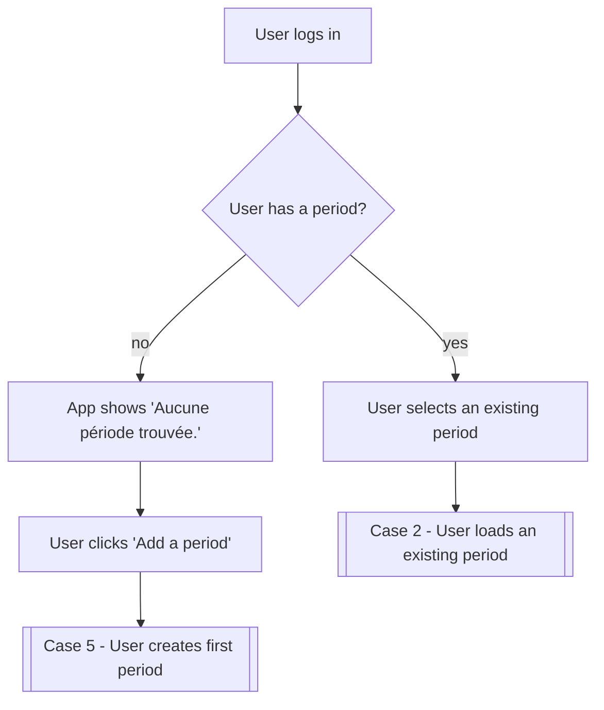
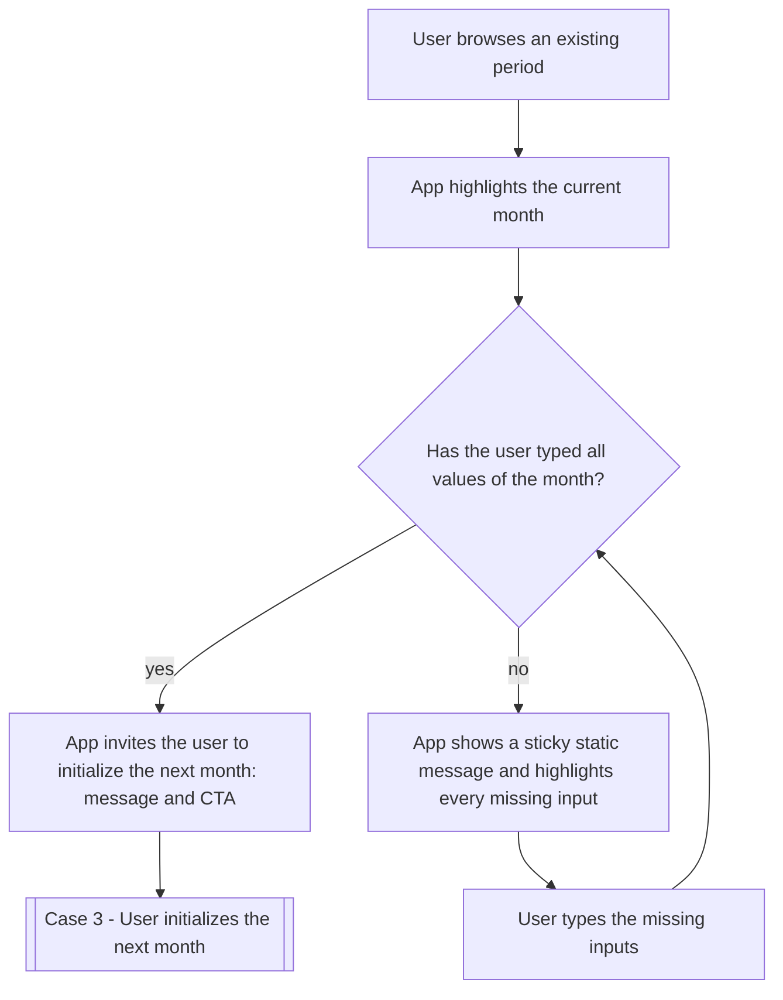
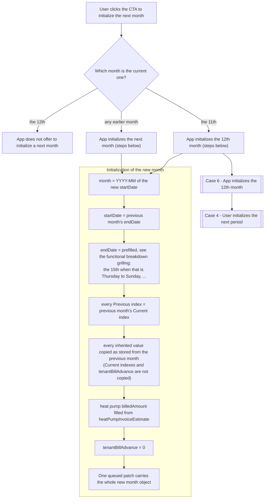
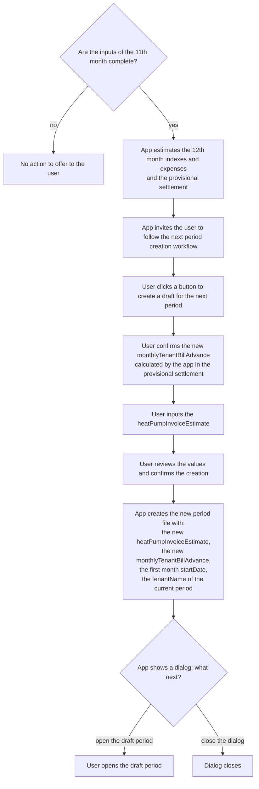
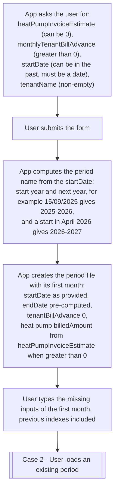
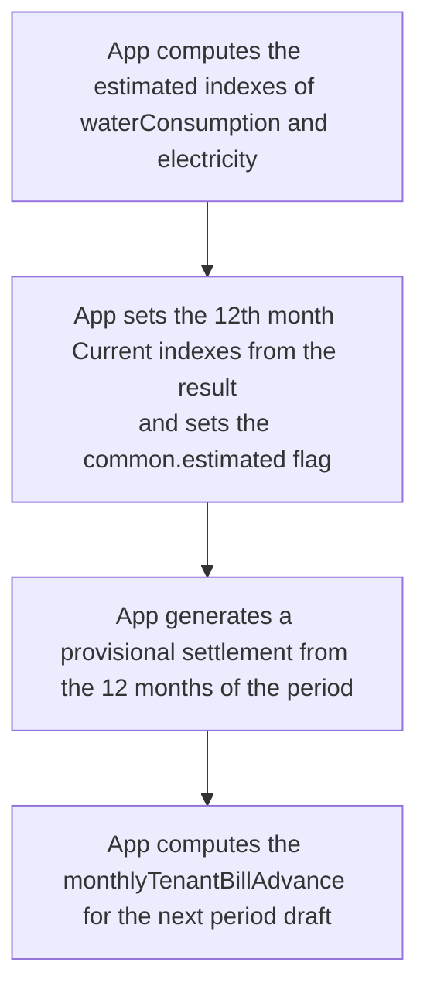
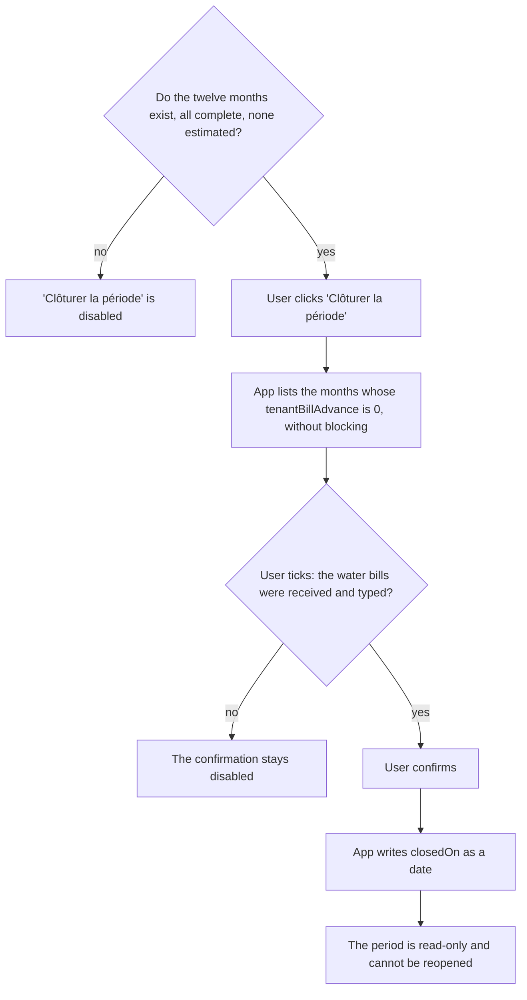
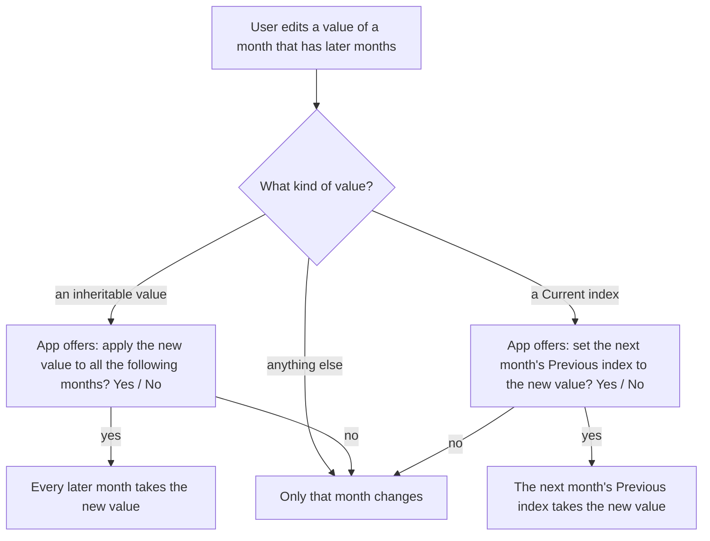

# Scenarios

The journeys the app must allow, settled in the grilling [`2026-11-17-simplify-file-structure-and-formulas`](grillings/2026-11-17-simplify-file-structure-and-formulas/GRILLING-SUMMARY.md). The file structure they act on is in [`period-file.md`](period-file.md).

## Case 1 - User logs in

## Case 2 - User loads an existing period

The app shows only the months present in the period file. The highlighted month is the one whose `startDate` and `endDate` contain the current date.

## Case 3 - User initializes the next month

The prefilled `endDate` follows the paragraph containing "It is suggested as the 15th when that is Thursday to Sunday [...]" of the [functional breakdown grilling](grillings/2026-10-26-functional-breakdown/GRILLING-SUMMARY.md).

## Case 4 - User initializes the next period

The estimate and the settlement follow the [period closing grilling](grillings/2026-10-29-period-closing/GRILLING-SUMMARY.md).

## Case 5 - User creates the first period

## Case 6 - App initializes the 12th month of a period

The estimate rules are in the [period closing grilling](grillings/2026-10-29-period-closing/GRILLING-SUMMARY.md) and in [`period-file.md`](period-file.md#the-estimated-twelfth-month). Confirming the real reading removes the `estimated` flag.

## Case 7 - User closes a period

## Case 8 - User edits a value of a past month

